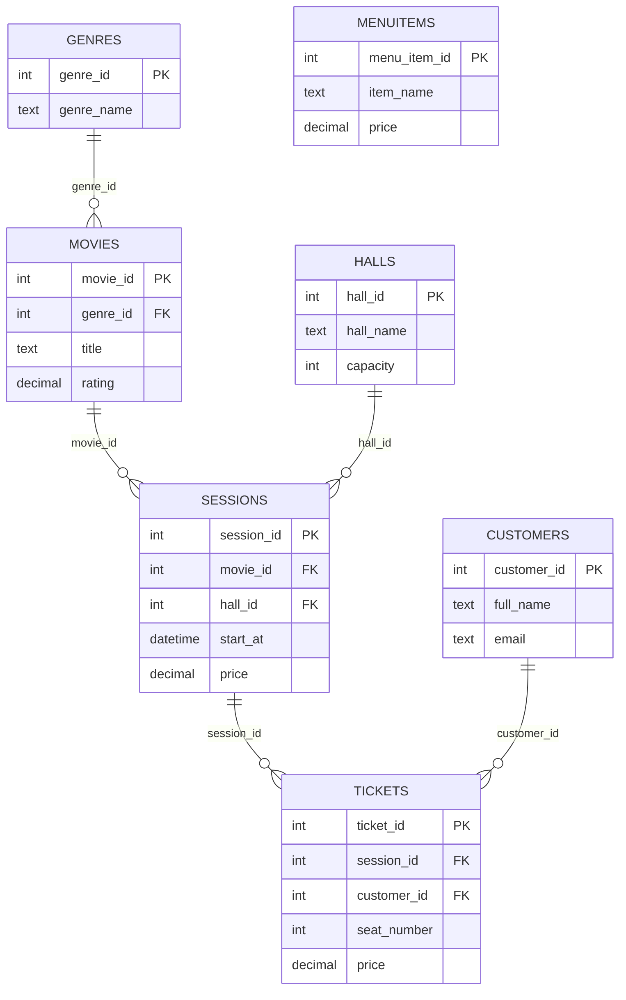

# Қарапайым Class Diagram / ER байланысы

Бұл сызбада №6 ЗЖ-дағы кесте және PK/FK байланыстары көрсетіледі.

`MenuItems` — тәуелсіз мәзір кестесі; қазіргі оқу нұсқасында тағамға тапсырыс функционалы жоқ.
