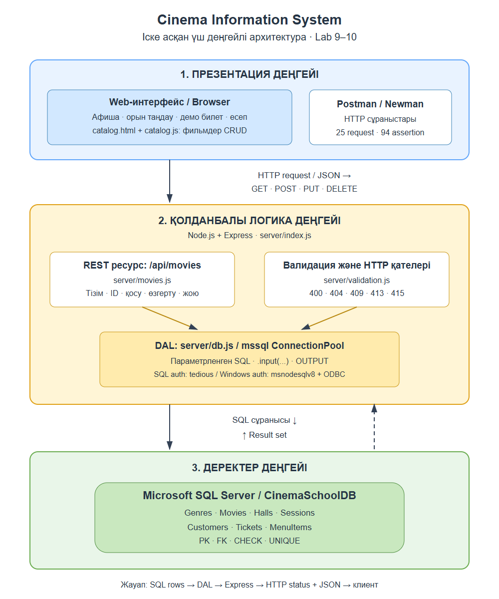
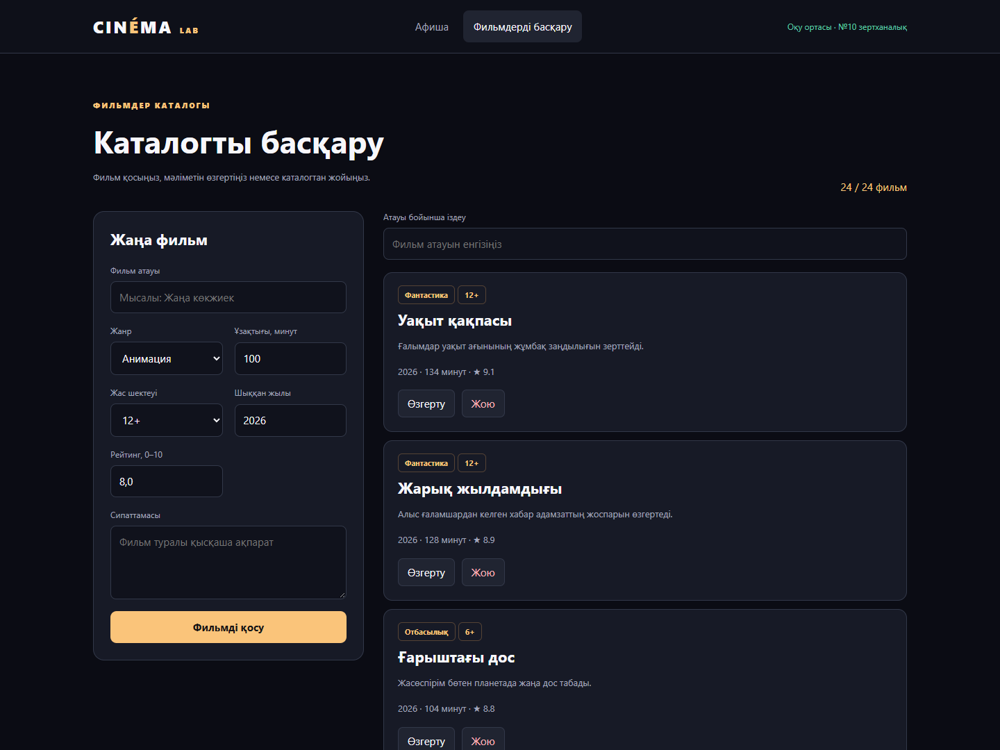

ЗЕРТХАНАЛЫҚ ЖҰМЫС №10

Ақпараттық жүйе
компоненттерінің
HTTP REST API арқылы
өзара әрекеттесуі

Cinema Information System

Фильмдер каталогына арналған толық CRUD API, SQL Server байланысы және Postman тестілеуі. №9 жұмыстың архитектурасы жобаға қосылды.

| Жоба | Тапсыру деректері |
| --- | --- |
| Орындаушы | Syrym / GitHub: Syrym1234 |
| Пәндік сала | Кинотеатрдың ақпараттық жүйесі |
| Технологиялар | Node.js · Express · Microsoft SQL Server |
| Нұсқа / күні | 1.1.0 / 04.11.2026 |
| Негізгі ресурс | /api/movies |
| Тексеру | 25 HTTP сұранысы · 94 assertion · 0 қате |

Дайын нәтиже

Жұмыс істейтін API және каталогты басқару беті; импортталатын Postman коллекциясы; OpenAPI спецификациясы; нақты тест журналдары; архитектура мен тоғыз бақылау сұрағының жауаптары.

[GitHub репозиторийі](https://github.com/Syrym1234/cinema-information-system1)

CINÉMA LAB  /  01

Мақсат және талаптардың орындалуы

---

Мақсат: клиент, сервер және деректер қоры арасындағы HTTP REST API алмасуын іске асырып, қосу, оқу, өзгерту және жою операцияларын нақты деректер қорында тексеру.

Негіз: пайдаланушы ұсынған 10-Lab.pdf нұсқаулығы. Ондағы кітапхана және MySQL - түсіндіруші мысал. Осы жұмыста API әдістері кинотеатрдың Movies ресурсына бейімделді. Бұрынғы CinemaSchoolDB, SQL Server және mssql драйвері сақталды; кітапхана жобасы бөлек жасалмайды.

| Нұсқаулық талабы | Жобадағы орындалуы |
| --- | --- |
| Node.js + Express сервері | server/index.js: HTTP сервері, JSON middleware, маршруттар |
| Деректер қорымен байланыс | server/db.js: ConnectionPool, SQL/Windows Authentication |
| Барлық жазбаларды алу | GET /api/movies -> 200, массив |
| ID бойынша жазбаны алу | GET /api/movies/:id -> 200 немесе 404 |
| Жаңа жазба қосу | POST /api/movies -> 201 + Location |
| Жазбаны өзгерту | PUT /api/movies/:id -> 200, толық жаңарту |
| Жазбаны жою | DELETE /api/movies/:id -> 200; FK байланысына 409 |
| Postman тестілеуі | 25 сұраныс, 94 assertion; нақты Newman журналы |
| Табылмаған ID | GET /api/movies/2147483647 -> 404 |
| Бақылау сұрақтары | Есептің 10-11-беттерінде 9 толық жауап |

№9 және №10 сабақтастығы

№9 жұмыстағы интерфейс -> қолданбалы логика -> деректер қоры байланысы №10 жұмыста нақты HTTP сұраныстарымен көрсетілді. DAL қолданбалы деңгейдің құрамында орналасады. Жергілікті сервер HTTP қолданады; HTTPS қосылды деген мәлімдеме жасалмайды.

CINÉMA LAB  /  02

Үш деңгейлі архитектура

---



1-сурет. Қазіргі кодқа сәйкес архитектура. Параметрлер серверде тексеріледі; SQL нәтижесі клиентке HTTP статусы және JSON ретінде қайтарылады. DAL бөлек төртінші деңгей емес.

Түпнұсқа №9 диаграммасы docs/lab9/ ішінде сақталған. Ондағы CinemaLabDB, төлем, QR және тағам тапсырысы - кеңейтілген мақсатты модель; осы нұсқаның жұмыс істейтін мүмкіндіктеріне қосып есептелмейді.

CINÉMA LAB  /  03

Деректер моделі және іске асыру

---

Деректер қоры: CinemaSchoolDB. Жеті пәндік кесте: Genres, Movies, Halls, Sessions, Customers, Tickets, MenuItems. Негізгі байланыстар: Genres 1:N Movies; Movies 1:N Sessions; Halls 1:N Sessions; Sessions 1:N Tickets; Customers 1:N Tickets.

| Movies өрісі | SQL түрі | API тексеруі |
| --- | --- | --- |
| movie_id | INT IDENTITY / PK | Сервер жасайды; ID: 1..2147483647 |
| title | NVARCHAR(150) | Бос емес жол; trim; ең көбі 150 таңба |
| genre_id | INT / FK -> Genres | JSON бүтін саны; базада бар жанр |
| duration_min | INT | 1..600 бүтін саны |
| age_rating | INT | 0, 6, 12, 16, 18 немесе 21 |
| release_year | INT | 1888..2100 бүтін саны |
| rating | DECIMAL(3,1) | 0..10; ең көбі бір ондық таңба |
| description | NVARCHAR(400) | Бос емес жол; trim; ең көбі 400 таңба |

Кодтың жауапкершіліктері

| Файл | Міндеті |
| --- | --- |
| server/index.js | Express баптауы, бұрынғы маршруттар, JSON қателері, серверді жабу |
| server/db.js | ConnectionPool, .env конфигурациясы, қосылымды жабу |
| server/movies.js | CRUD маршруттары және SQL параметрлері |
| server/validation.js | ID, өрістер, типтер мен диапазондар |
| public/catalog.* | Каталог интерфейсі және fetch сұраныстары |

Жою ережесі: фильмге сеанс байланысқан болса, SQL Server FK шектеуі жоюды тоқтатады. API 409 MOVIE_HAS_SESSIONS қайтарады. Бар сеанстар мен билеттер автоматты өшірілмейді.

CINÉMA LAB  /  04

REST келісімі: оқу және қосу

---

| Әдіс | Endpoint | Сәтті жауап |
| --- | --- | --- |
| GET | /api/movies | 200 / JSON массив |
| GET | /api/movies/:id | 200 / фильм + genre_name |
| POST | /api/movies | 201 / фильм + Location |
| PUT | /api/movies/:id | 200 / жаңартылған фильм |
| DELETE | /api/movies/:id | 200 / message + movie_id |

GET - барлық фильм және ID бойынша фильм

```
GET http://127.0.0.1:3000/api/movies
GET http://127.0.0.1:3000/api/movies/28
```

Тізім рейтинг кемуі, атау және movie_id бойынша сұрыпталады. ID нәтижеде болмаса, 404 MOVIE_NOT_FOUND қайтарылады. 28 - сақталған тесттің ID мысалы; басқа іске қосуда ID өзгереді.

POST - жаңа фильм

```
POST /api/movies
Content-Type: application/json

{
  "title": "Lab10 | Қазақша фильм",
  "genre_id": 6,
  "duration_min": 110,
  "age_rating": 12,
  "release_year": 2026,
  "rating": 8.5,
  "description": "REST API арқылы қосылған оқу фильмі."
}
```

Жауап: 201 Created; Location: /api/movies/28. JSON ішінде movie_id және сақталған жеті өріс бар. Жанр ID /api/metadata нәтижесінен алынады; мысалдағы 6 мәнін өз базаңыздың мәнімен ауыстырыңыз.

Қазақша мәтін NVARCHAR параметрімен беріледі. movie_id клиенттен қабылданбайды. POST және PUT белгісіз өрістерді қабылдамайды; мәтіндік санның орнына JSON санын жіберу қажет.

CINÉMA LAB  /  05

REST келісімі: өзгерту, жою және қателер

---

PUT - барлық жазылатын өрісті ауыстыру

```
PUT /api/movies/{{movieId}}
Content-Type: application/json

{
  "title": "Lab10 | Жаңартылған фильм",
  "genre_id": 6,
  "duration_min": 110,
  "age_rating": 12,
  "release_year": 2026,
  "rating": 9.1,
  "description": "REST API арқылы қосылған оқу фильмі."
}
```

Жауап: 200 OK және жаңартылған объект. Кейінгі GET сұранысы title және rating мәндерінің деректер қорында сақталғанын дәлелдейді. PUT барлық жеті өрісті талап етеді; бұл API-де PATCH іске асырылмаған.

DELETE - байланысы жоқ фильмді жою

```
DELETE /api/movies/{{movieId}}

200 OK
{"message":"Фильм сәтті жойылды","movie_id":28}

GET /api/movies/28
404 Not Found
{"error":"Фильм табылмады","code":"MOVIE_NOT_FOUND"}
```

| Статус | Қай жағдайда |
| --- | --- |
| 400 | Қате ID / JSON / өрістер / базада жоқ жанр |
| 404 | Фильм немесе API маршруты табылмады |
| 405 | Қолдау жоқ әдіс; Allow header беріледі |
| 409 | Фильмге сеанстар байланысқан |
| 413 / 415 | JSON 16 KB шегінен үлкен / Content-Type қате |
| 500 / 503 | Ішкі сервер қатесі / деректер қорына қосылу мүмкін емес |

SQL мәндері .input(...) арқылы параметрленеді. INSERT пен UPDATE нәтижесі OUTPUT INSERTED.* арқылы, DELETE нәтижесі OUTPUT DELETED.movie_id арқылы алынады. Бұл бөлек кейінгі SELECT сұранысына тәуелділікті жояды.

CINÉMA LAB  /  06

Іске қосу және Postman нұсқаулығы

---

1. Тәуелділіктер және база

```
npm ci
Copy-Item .env.example .env
```

Node.js 20+ қажет. Таза база үшін sql/01_create_database.sql, кейін sql/02_insert_data.sql файлдарын SSMS-та бір рет орындаңыз. Бар деректерге қайта seed жасамаңыз. №10 үшін жаңа кесте немесе миграция қажет емес.

2. Осы компьютерде тексерілген Windows Authentication

```
DB_AUTH=windows
DB_SERVER=.\SQLEXPRESS
DB_NAME=CinemaSchoolDB
DB_ENCRYPT=false
DB_TRUST_CERT=true
HOST=127.0.0.1
PORT=3000
```

Атаулы instance қолданғанда DB_PORT жолын алып тастаңыз. msnodesqlv8 және ODBC Driver 17 қолданылады. SQL Authentication үшін DB_AUTH=sql, DB_USER, DB_PASSWORD, DB_SERVER және DB_PORT баптаңыз. .env құпия файл ретінде Git-ке қосылмайды.

```
npm start
# Басқа терминалда:
npm test
npm run test:postman
```

3. Postman desktop-та тексеру

Import арқылы postman/CinemaLab10.postman_collection.json және Local.postman_environment.json файлдарын импорттаңыз. Cinema Local ортасын таңдаңыз. baseUrl = http://127.0.0.1:3000. Run collection пәрменімен бір итерацияны берілген ретпен орындаңыз.

Коллекция жанр ID, қорғалған фильм ID және жаңа movieId мәндерін өзі алады. Соңғы қадамдар өз уақытша фильмін жойып, бастапқы фильм санын тексереді. Каталогты қатар өзгертпей тестілеңіз. Тест үзіліп қалса, тек өзінің Lab10 атаулы тест фильмін тазалаңыз.

CLI дәлелі Newman 6.2.3 арқылы алынды. Ол npx арқылы бөлек іске қосылатын тест құралы; upstream тәуелділік ескертулері болуы мүмкін. Қосымшаның орнатылатын тәуелділіктерінде npm audit нәтижесі - 0 осалдық.

CINÉMA LAB  /  07

Нақты API тест нәтижелері

---

04.11.2026: SQL Express / CinemaSchoolDB; Postman коллекциясы Newman арқылы орындалды. 25 сұраныс, 94 assertion, 0 failure. HTTP қате статустары - әдейі тексерілген күтілетін нәтижелер.

| № | Әдіс | Сценарий | HTTP | Нәтиже |
| --- | --- | --- | --- | --- |
| 1 | GET | SQL байланысы | 200 | PASS |
| 2 | GET | Жанрлар | 200 | PASS |
| 3 | GET | Барлық фильм | 200 | PASS |
| 4 | GET | Сеанс / FK тесті | 200 | PASS |
| 5 | POST | Фильм қосу | 201 | PASS |
| 6 | GET | ID бойынша оқу | 200 | PASS |
| 7 | PUT | Фильмді өзгерту | 200 | PASS |
| 8 | GET | Сақталған өзгерісті оқу | 200 | PASS |
| 9 | POST | Бос міндетті өрістер | 400 | PASS |
| 10 | PUT | Қате рейтинг | 400 | PASS |
| 11 | POST | Жоқ жанр | 400 | PASS |
| 12 | GET | SQL injection ID | 400 | PASS |
| 13 | GET | SQL INT overflow | 400 | PASS |
| 14 | GET | Жоқ фильм | 404 | PASS |
| 15 | PUT | Жоқ фильмді өзгерту | 404 | PASS |
| 16 | DELETE | Байланысқан фильмді жою | 409 | PASS |
| 17 | POST | Бұзылған JSON | 400 | PASS |
| 18 | POST | Қате Content-Type | 415 | PASS |
| 19 | POST | 16 KB шегінен артық | 413 | PASS |
| 20 | PATCH | Қолдау жоқ PATCH | 405 | PASS |
| 21 | GET | Жоқ маршрут | 404 | PASS |
| 22 | DELETE | Өз тест фильмін жою | 200 | PASS |
| 23 | GET | Жойылған фильмді оқу | 404 | PASS |
| 24 | DELETE | Қайталап жою | 404 | PASS |
| 25 | GET | Бастапқы сан қалпына келді | 200 | PASS |

Қосымша дәлел: 11 unit test және 11 браузер тексеруі өтті. Журналдар: docs/lab10/evidence/newman-results.json, newman-console.txt, unit-tests.txt, browser-results.json. Тест фильмдері тазаланды; бастапқы каталогта 24 фильм қалды.

CINÉMA LAB  /  08

Браузердегі жұмыс нәтижесі

---



2-сурет. Каталогты басқару: desktop 1440 × 1080. Скриншот нақты жергілікті қолданбадан алынды. Форма деректерді API арқылы SQL Server-ге жібереді.

Тексерілген пайдаланушы әрекеттері

Жаңа фильмді формада қосу -> нақты SQL жолын оқу -> рейтингті 9.4 мәніне өзгерту -> өзгерісті қайта оқу -> растау терезесімен жою -> жойылған ID үшін 404 алу. Сеансы бар фильмді жою әрекеті тиісті хабарламамен тоқтатылды.

Мобильді 390 × 844 өлшемінде көлденең тасу жоқ. Бұрынғы фильмдер беті мен сатылым есебі жүктелді. Тексеру кезінде ұстатылмаған JavaScript қатесі тіркелмеді.

catalog-mobile.png және report-desktop.png қосымша скриншоттары evidence/ бумасында бар. Бұл суреттер Postman терезесінің скриншоты деп көрсетілмейді: олар браузер интерфейсінің нақты дәлелі.

CINÉMA LAB  /  09

Бақылау сұрақтары: 1-5

---

1. API дегеніміз не және не үшін қолданылады?

API (Application Programming Interface) - бағдарламалардың бір-біріне функция немесе дерек ұсыну келісімі. Кинотеатрда браузер /api/movies ресурсына сұраныс жібереді, сервер SQL деректерін JSON ретінде қайтарады. Клиентке SQL қосылымының құпиясөзі қажет емес.

2. REST API архитектурасының негізгі ерекшеліктері қандай?

Ресурстар URI арқылы анықталады, әрекеттер HTTP әдістерімен беріледі, клиент пен сервер бөлінеді. Stateless қағидасы бойынша әр сұраныс оны өңдеуге қажетті мәліметті өзі қамтиды. Жауапта HTTP статусы және ресурс көрінісі болады. REST үшін GET қауіпсіз, PUT пен DELETE мағыналық жағынан idempotent: қайталау ресурстың соңғы күйін өзгертпейді; жауап статусы өзгеруі мүмкін.

3. HTTP протоколы API жұмысына қалай қатысады?

HTTP сұраныс әдісін, URL-ін, header мен body құрылымын және жауап статусын анықтайды. Мысалы, POST + Content-Type: application/json фильм деректерін жібереді, сервер 201 Created қайтарады. 400 кіріс қатесін, 404 жоқ ресурсты, 409 деректер байланысының қайшылығын көрсетеді. HTTPS HTTP хабарларын TLS арқылы шифрлайды; осы жергілікті оқу нұсқасы HTTP қолданады.

4. CRUD операцияларының мағынасы қандай?

Create - жаңа жазба құру; Read - жазбаларды оқу; Update - жазбаны жаңарту; Delete - жазбаны жою. Бұл жобада сәйкестік: POST -> INSERT, GET -> SELECT, PUT -> UPDATE, DELETE -> DELETE. Операциялар браузердегі массивпен ғана шектелмей, SQL Server кестесінде орындалады.

5. GET және POST әдістерінің айырмашылығы қандай?

GET ресурсты оқиды және сервердің пәндік күйін өзгертпеуі тиіс; фильтрлер query параметрлерімен берілуі мүмкін. POST жаңа ресурс құрады, оның деректері body ішінде жіберіледі. POST-ты қайталау бірнеше жаңа жазба құруы мүмкін. Осы API-де GET 200, сәтті POST 201 және жаңа ресурсқа Location header қайтарады.

CINÉMA LAB  /  10

Бақылау сұрақтары: 6-9

---

6. PUT және DELETE не үшін қолданылады?

PUT көрсетілген URI-дегі ресурстың жазылатын деректерін толық ауыстырады; осы жобада жеті өріс міндетті. DELETE ресурсты жояды. Біздің API-де жоқ ID 404, ал сеансқа байланысқан фильм 409 қайтарады. Бір фильмді қайталап жою бастапқы жоюдан кейін 404 береді, бірақ соңғы күйі өзгермейді: ресурс жоқ.

7. JSON қандай рөл атқарады?

JSON - тілден тәуелсіз мәтіндік дерек форматы. Объект, массив, жол, сан, boolean және null мәндерін қолдайды. Express JSON body-ді JavaScript объектісіне айналдырады; res.json(...) жауап сериализациясын орындайды. JSON санын жолға алмастыру дұрыс емес: мысалы rating: 8.5 қабылданады, ал rating: "8.5" қабылданбайды.

8. Node.js пен Express қызметі қандай?

Node.js JavaScript-ті серверде орындайды және асинхронды енгізу/шығаруды басқарады. Express HTTP маршруттарды, middleware тізбегін, сұраныс пен жауап объектілерін ұсынады. mssql SQL Server қосылымын басқарады. Express 4 асинхронды қателері Promise.catch(next) арқылы орталық error middleware-ге жіберіледі.

9. Postman арқылы API қалай тестіленеді?

HTTP әдісін, URL, header және қажет body мәнін таңдап Send орындалады. Post-response script ішінде pm.test және pm.expect арқылы статус пен JSON тексеріледі. Коллекция Runner арқылы ретімен орындалып, жаңа ID айнымалыға сақталады. Осы жұмыста GET -> POST -> GET -> PUT -> GET -> DELETE -> GET 404 тізбегі және қате сценарийлер тексерілген.

Қолданылу шекарасы және дереккөздер

Бұл жергілікті оқу жүйесі. Аккаунттар, рөлдер, нақты төлем, QR және HTTPS конфигурациясы ауқымға кірмейді. №8 SQL файлы кеңейтілген CinemaLabDB схемасына арналған; осы CinemaSchoolDB орнату тізіміне кірмейді.

[Express 4: Error Handling](https://expressjs.com/en/4x/guide/error-handling/)

[Microsoft Learn: OUTPUT clause](https://learn.microsoft.com/en-us/sql/t-sql/queries/output-clause-transact-sql)

[Postman: test scripts](https://learning.postman.com/docs/tests-and-scripts/write-scripts/test-scripts/)

[Postman: Collection Runner](https://learning.postman.com/docs/tests-and-scripts/running-collections/intro-to-collection-runs)

Бастапқы материалдар: пайдаланушы берген 10-Lab.pdf (6 бет) және CinemaLab9_ExampleStyle_FINAL.png; жобаның SQL схемасы мен сервер коды.

CINÉMA LAB  /  11

Қосымша: №9 жұмыстың түпнұсқасы

---


3-сурет. Пайдаланушы ұсынған сурет өзгертілмеген. Суреттегі кеңейтілген модульдер мен CinemaLabDB - мақсатты архитектура. Нақты жеті кестелік CinemaSchoolDB нұсқасы есептің 3-бетіндегі диаграммада көрсетілді. Толық өлшемді PNG docs/lab9/ ішінде берілген.
