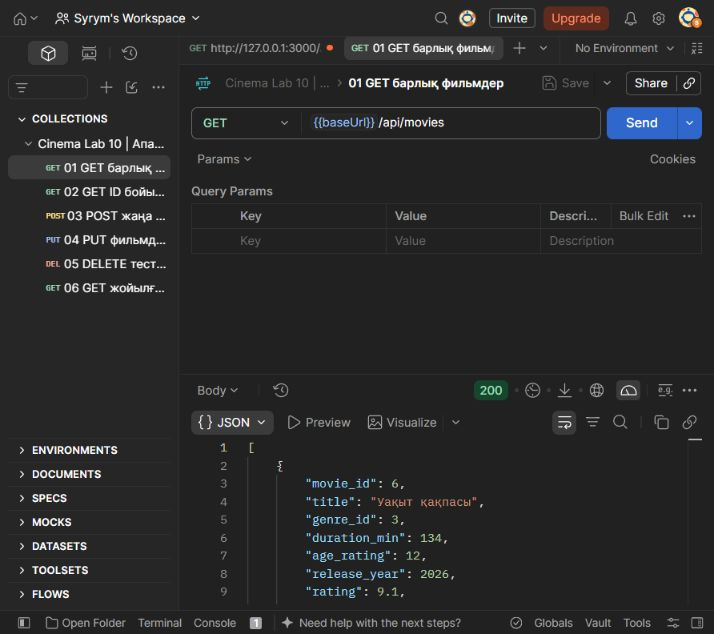
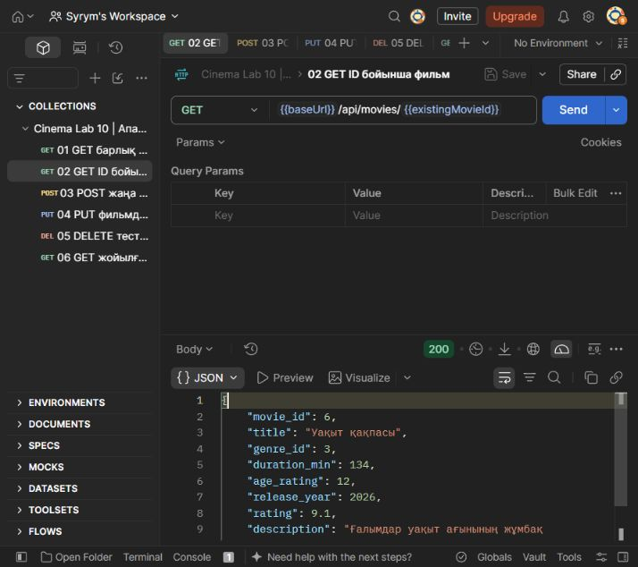
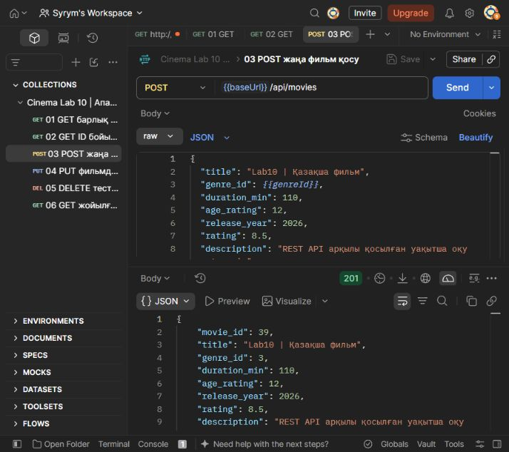
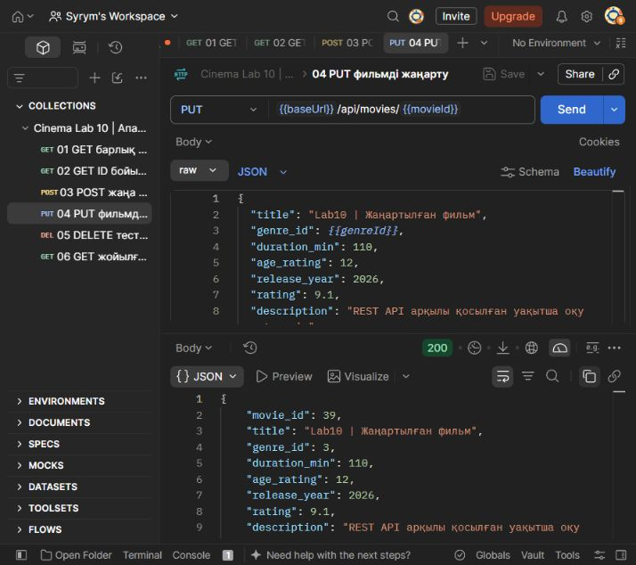
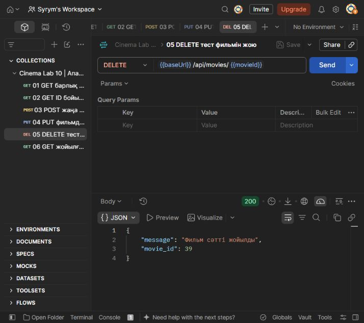
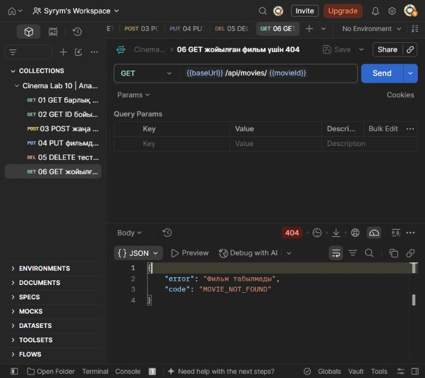

# №10 ЗЕРТХАНАЛЫҚ ЖҰМЫС

Тақырыбы: REST API құру және Postman арқылы тестілеу

Жоба: Cinema Information System кинотеатрдың ақпараттық жүйесі

Орындаған: Бақтыбек Сырым Абайұлы

Тобы: ИС 24-02

2026 жыл

## 1. Жұмыстың мақсаты

Node.js және Express арқылы REST API құру, оны Microsoft SQL Server деректер қорымен байланыстыру және GET, POST, PUT, DELETE әдістерін тексеру. Нұсқаулықтағы кітаптар мысалы кинотеатр жобасының Movies кестесіне бейімделді.

## 2. Қолданылған құралдар

Visual Studio Code бағдарламалық кодты жазу үшін қолданылды. Node.js және Express API серверін іске қосады. mssql және msnodesqlv8 SQL Server-ге Windows Authentication арқылы қосылады. Негізгі алты HTTP сұранысы Postman Web клиентінде Send батырмасы арқылы орындалды. Жергілікті API-ге Postman Desktop Agent 0.5.2 арқылы қосылды. Қосымша автоматты тексеру Newman арқылы жүргізілді.

## 3. Жүйе және дерекқор құрылымы

SQL Server instance: .\SQLEXPRESS. Деректер қоры: CinemaSchoolDB. Movies кестесінің өрістері: movie_id (INT, PK), title (NVARCHAR), genre_id (INT, FK), duration_min, age_rating, release_year (INT), rating (DECIMAL) және description (NVARCHAR). Movies кестесі Genres және Sessions кестелерімен байланысқан.

Жоба құрылымы: server/db.js деректер қорына қосылуды басқарады; server/movies.js CRUD маршруттарын өңдейді; server/validation.js кіріс деректерін тексереді; server/index.js Express серверін іске қосады; public/catalog.html және public/catalog.js каталог интерфейсін ұсынады.

## 4. Орындалу барысы

### 4.1. Node.js ортасын дайындау

Жобаның түбірінде npm ci командасымен тәуелділіктер орнатылды. .env.example негізінде .env файлы бапталды. Сервер npm start арқылы http://127.0.0.1:3000 мекенжайында іске қосылды.

### 4.2. SQL Server деректер қорына қосылу

server/db.js Windows Authentication арқылы .\SQLEXPRESS instance-іне қосылды. DB_NAME=CinemaSchoolDB параметрі қолданылды. GET /api/health сұранысы 200 OK қайтарып, database атауы CinemaSchoolDB және movies саны 24 екенін растады.

### 4.3. REST API құру

GET /api/movies, GET /api/movies/:id, POST /api/movies, PUT /api/movies/:id және DELETE /api/movies/:id маршруттары әзірленді. SQL мәндері .input() арқылы параметрленді. POST және PUT жеті жазылатын өрісті талап етеді. Жоқ фильмге 404, қате өріске 400, сеансы бар фильмді жоюға 409 қайтарылады.

### 4.4. Postman Web арқылы тексеру

| Әдіс | Endpoint | Нәтиже |
| --- | --- | --- |
| GET | /api/movies | 200 OK фильмдер тізімі |
| GET | /api/movies/6 | 200 OK ID бойынша фильм |
| POST | /api/movies | 201 Created ID=39 |
| PUT | /api/movies/39 | 200 OK рейтинг 9.1 |
| DELETE | /api/movies/39 | 200 OK фильм жойылды |
| GET | /api/movies/39 | 404 Not Found |

Postman Web клиентінде GET арқылы фильмдер тізімі және ID=6 фильмі оқылды. POST жаңа тест фильмін құрды: ID=39, рейтинг 8.5. PUT рейтингі 9.1 мәніне жаңартты. DELETE тест фильмін жойды. Сол ID бойынша кейінгі GET 404 Not Found қайтарды. Төменде Postman терезесінен алынған нақты скриншоттар берілген.

## 5. Практикалық нәтижелердің скриншоттары

### 5.1. Барлық фильмдерді оқу

GET http://127.0.0.1:3000/api/movies сұранысы 200 кодымен JSON массивін қайтарды. Каталогта 24 фильм бар. baseUrl айнымалысы жергілікті сервердің осы адресін сақтайды.

1-сурет. Postman GET барлық фильмдер 200 OK.

### 5.2. Фильмді ID бойынша оқу

GET /api/movies/6 сұранысы 200 кодымен бір фильмді қайтарды. existingMovieId айнымалысы бірінші GET жауабындағы фильмнің ID мәнін сақтайды.

2-сурет. Postman GET фильмді ID бойынша оқу 200 OK.

### 5.3. Жаңа фильм қосу

POST /api/movies сұранысының Body бөлімінде raw және JSON таңдалды. Жаңа фильмге сервер ID=39 тағайындады; жауап коды 201, бастапқы рейтинг 8.5. movieId айнымалысы осы ID мәнін сақтайды.

3-сурет. Postman POST жаңа фильм 201 Created ID=39.

### 5.4. Фильмді жаңарту

PUT /api/movies/39 сұранысы жеті жазылатын өрісті жіберді. Фильм атауы жаңартылып, рейтингі 9.1 болды. Жауап коды 200; SQL SELECT сол мәннің деректер қорында сақталғанын растады.

4-сурет. Postman PUT жаңартылған рейтинг 9.1 200 OK.

### 5.5. Тест фильмін жою

DELETE /api/movies/39 сұранысы осы жұмыс барысында құрылған уақытша фильмді жойды. Сервер 200 кодын және «Фильм сәтті жойылды» хабарламасын қайтарды.

5-сурет. Postman DELETE тест фильмі жойылды 200 OK.

### 5.6. Жойылған фильмді іздеу

GET /api/movies/39 сұранысы 404 және MOVIE_NOT_FOUND кодын қайтарды. Бұл тексеруде 404 күтілетін нәтиже: жойылған ресурс қайта оқылмайды. SQL тексеруі ID=39 жазбасының жоқ екенін растады.

6-сурет. Postman GET жойылған ID=39 үшін 404 Not Found.

## 6. Бақылау сұрақтарына жауаптар

1. API дегеніміз не және ол қандай мақсатта қолданылады?

API (Application Programming Interface) бағдарламалардың бір-бірімен әрекеттесуін қамтамасыз ететін келісім. Ол клиент сұранысын қабылдап, сервер қызметтері мен деректерін ұсынады. Біздің жобада API фильмдерді оқу, қосу, жаңарту және жою үшін қолданылады.

2. REST API архитектурасының негізгі ерекшеліктері қандай?

REST ресурстарға бағытталады: әр ресурс URI арқылы анықталады, әрекеттер стандартты HTTP әдістерімен орындалады. Клиент пен сервер бөлінеді. Stateless қағидасы бойынша әр сұраныс өңдеуге жеткілікті ақпарат қамтиды. Жауапта HTTP статусы мен ресурс көрінісі беріледі.

3. HTTP протоколы API жұмысына қалай қатысады?

HTTP клиент пен сервер арасында сұраныс және жауап тасымалдайды. Клиент әдісті, URL, header және қажет болса JSON body жібереді. Сервер статус кодын және жауап деректерін қайтарады. Мысалы, POST /api/movies сұранысына 201 Created қайтарылды.

4. CRUD операцияларының мағынасын түсіндіріңіз.

CRUD: Create жаңа жазба құру, Read деректі оқу, Update жаңарту, Delete жою. Жобада олар POST, GET, PUT және DELETE әдістеріне сәйкес келеді. SQL Server-де INSERT, SELECT, UPDATE және DELETE орындалады.

5. GET және POST әдістерінің айырмашылығы қандай?

GET серверден дерек алады және ресурстың күйін өзгертпеуі тиіс. POST жаңа ресурс құру үшін body ішіндегі деректерді жібереді. Біздің жобада GET фильмдер тізімін қайтарды, POST жаңа фильм қосты. POST-ты қайталау бірнеше жазба құруы мүмкін.

6. PUT және DELETE әдістері қандай мақсатта қолданылады?

PUT көрсетілген фильмнің барлық жазылатын өрісін ауыстырады. DELETE берілген ID бойынша фильмді жояды. Тексеруде ID=39 фильмі жаңартылып, кейін жойылды. Сеансы бар фильмді жою 409 Conflict жауабымен тоқтатылады.

7. JSON форматы API арқылы деректер алмасуда қандай рөл атқарады?

JSON құрылымды деректерді мәтін түрінде жеткізеді. Объект, массив, жол, сан, boolean және null мәндерін қолдайды. Фильмнің title, genre_id, rating және басқа өрістері JSON арқылы берілді. Мысалы, rating: 8.5 сан болып жіберіледі, ал «8.5» жолы қабылданбайды.

8. Node.js пен Express технологияларының қызметі қандай?

Node.js JavaScript кодын серверде орындайды. Express маршруттарды, middleware және JSON жауаптарын өңдеуді жеңілдетеді. mssql деректер қорымен байланысады. Жобада Express /api/movies ресурсындағы сұраныстарды өңдеп, нәтиже SQL Server-де сақталды.

9. Postman бағдарламасы арқылы API қалай тестіленеді?

Postman-да әдіс пен URL таңдалады. POST және PUT үшін Body raw JSON бөліміне деректер енгізіледі. Send орындалғаннан кейін статус пен JSON тексеріледі. Коллекция Runner немесе Newman арқылы ретімен орындалады. Бұл жұмыста 201, 200, 400, 404, 409 және басқа күтілетін статустар тексерілді.

## 7. Қорытынды

Cinema Information System жобасындағы REST API SQL Server деректер қорымен байланыстырылды. Postman Web клиентінде фильмдер тізімін және жеке фильмді оқу, жаңа фильм қосу, жаңарту, жою және жойылған фильмді іздеу орындалды. 200, 201 және 404 жауаптары нақты бағдарламада тексерілді. Қосымша Postman коллекциясының 25 сұранысы мен 94 assertion Newman арқылы сәтті өтті. Клиент, Express сервері және SQL Server арасындағы әрекеттесу тәжірибеде көрсетілді.

Жұмыс жергілікті оқу ортасында тексерілді. Уақытша тест фильмдері тазаланып, бастапқы каталогтағы 24 фильм сақталды.
