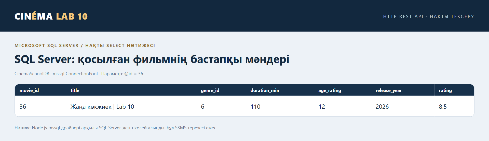
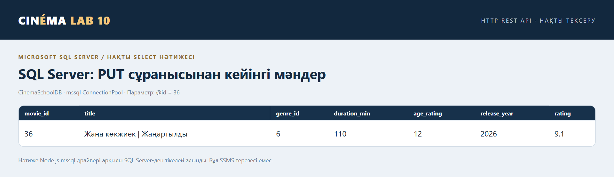
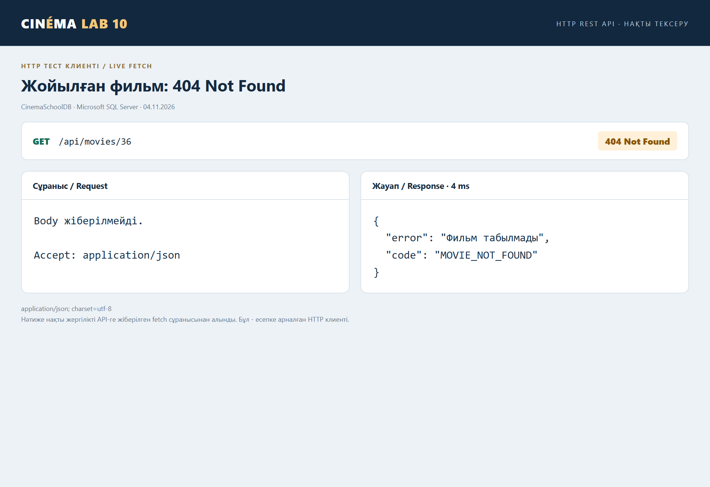

# №10 ЗЕРТХАНАЛЫҚ ЖҰМЫС

Тақырыбы: REST API құру және Postman арқылы тестілеу

Жоба: Cinema Information System кинотеатрдың ақпараттық жүйесі

Орындаған: Бақтыбек Сырым Абайұлы

Тобы: ИС 24-02

2026 жыл

## 1. Жұмыстың мақсаты

Node.js және Express арқылы REST API құру, оны Microsoft SQL Server деректер қорымен байланыстыру және GET, POST, PUT, DELETE әдістерін тексеру. Нұсқаулықтағы кітаптар мысалы кинотеатр жобасының Movies кестесіне бейімделді.

## 2. Қолданылған құралдар

Visual Studio Code бағдарламалық кодты жазу үшін қолданылды. Node.js v24.20.0 және Express серверді іске қосады; mssql, msnodesqlv8 және ODBC Driver 17 Windows Authentication арқылы SQL Server-ге қосылады. Postman коллекциясы Newman 6.2.3 арқылы орындалды. Скриншоттар браузерлік HTTP клиентінен және SQL Server SELECT нәтижелерінен алынды.

## 3. Жүйе және дерекқор құрылымы

SQL Server instance: .\SQLEXPRESS. Деректер қоры: CinemaSchoolDB. Movies кестесінің өрістері: movie_id (INT, PK), title (NVARCHAR), genre_id (INT, FK), duration_min, age_rating, release_year (INT), rating (DECIMAL) және description (NVARCHAR). Movies кестесі Genres және Sessions кестелерімен байланысқан.

Жоба құрылымы: server/db.js деректер қорына қосылуды басқарады; server/movies.js CRUD маршруттарын өңдейді; server/validation.js кіріс деректерін тексереді; server/index.js Express серверін іске қосады; public/catalog.html және public/catalog.js каталог интерфейсін ұсынады.

## 4. Орындалу барысы

### 4.1. Node.js ортасын дайындау

Жобаның түбірінде npm ci командасымен тәуелділіктер орнатылды. .env.example негізінде .env файлы бапталды. Сервер npm start арқылы http://127.0.0.1:3000 мекенжайында іске қосылды.

### 4.2. SQL Server деректер қорына қосылу

server/db.js Windows Authentication арқылы .\SQLEXPRESS instance-іне қосылды. DB_NAME=CinemaSchoolDB параметрі қолданылды. GET /api/health сұранысы 200 OK қайтарып, database атауы CinemaSchoolDB және movies саны 24 екенін растады.

### 4.3. REST API құру

GET /api/movies, GET /api/movies/:id, POST /api/movies, PUT /api/movies/:id және DELETE /api/movies/:id маршруттары әзірленді. SQL мәндері .input() арқылы параметрленді. POST және PUT жеті жазылатын өрісті талап етеді. Жоқ фильмге 404, қате өріске 400, сеансы бар фильмді жоюға 409 қайтарылады.

### 4.4. Postman коллекциясы арқылы тексеру

| Әдіс | Endpoint | Нәтиже |
| --- | --- | --- |
| GET | /api/movies | 200 OK фильмдер тізімі |
| GET | /api/movies/36 | 200 OK ID бойынша фильм |
| POST | /api/movies | 201 Created ID=36 |
| PUT | /api/movies/36 | 200 OK рейтинг 9.1 |
| DELETE | /api/movies/36 | 200 OK фильм жойылды |
| GET | /api/movies/36 | 404 Not Found |

POST арқылы «Жаңа көкжиек | Lab 10» фильмі қосылды: ID=36, рейтинг 8.5. PUT арқылы атауы «Жаңа көкжиек | Жаңартылды», рейтингі 9.1 болып өзгертілді. SQL Server-ге тікелей SELECT сұранысы екі күйді де растады. DELETE кейінгі GET сұранысы 404 Not Found қайтарды. Postman коллекциясындағы 25 сұраныс пен 94 assertion Newman арқылы сәтті орындалды.

## 5. Практикалық нәтижелердің скриншоттары

1-сурет. POST 201 Created жаңа фильм қосылды ID=36.

2-сурет. SQL Server бастапқы рейтинг 8.5 мәнін растады.

3-сурет. PUT 200 OK атауы мен рейтингі жаңартылды.

4-сурет. SQL Server жаңартылған рейтинг 9.1 мәнін растады.

5-сурет. DELETE 200 OK тест фильмі жойылды.

6-сурет. GET жойылған ID=36 үшін 404 Not Found қайтарды.

## 6. Бақылау сұрақтарына жауаптар

1. API дегеніміз не және ол қандай мақсатта қолданылады?

API (Application Programming Interface) бағдарламалардың бір-бірімен әрекеттесуін қамтамасыз ететін келісім. Ол клиент сұранысын қабылдап, сервер қызметтері мен деректерін ұсынады. Біздің жобада API фильмдерді оқу, қосу, жаңарту және жою үшін қолданылады.

2. REST API архитектурасының негізгі ерекшеліктері қандай?

REST ресурстарға бағытталады: әр ресурс URI арқылы анықталады, әрекеттер стандартты HTTP әдістерімен орындалады. Клиент пен сервер бөлінеді. Stateless қағидасы бойынша әр сұраныс өңдеуге жеткілікті ақпарат қамтиды. Жауапта HTTP статусы мен ресурс көрінісі беріледі.

3. HTTP протоколы API жұмысына қалай қатысады?

HTTP клиент пен сервер арасында сұраныс және жауап тасымалдайды. Клиент әдісті, URL, header және қажет болса JSON body жібереді. Сервер статус кодын және жауап деректерін қайтарады. Мысалы, POST /api/movies сұранысына 201 Created қайтарылды.

4. CRUD операцияларының мағынасын түсіндіріңіз.

CRUD: Create жаңа жазба құру, Read деректі оқу, Update жаңарту, Delete жою. Жобада олар POST, GET, PUT және DELETE әдістеріне сәйкес келеді. SQL Server-де INSERT, SELECT, UPDATE және DELETE орындалады.

5. GET және POST әдістерінің айырмашылығы қандай?

GET серверден дерек алады және ресурстың күйін өзгертпеуі тиіс. POST жаңа ресурс құру үшін body ішіндегі деректерді жібереді. Біздің жобада GET фильмдер тізімін қайтарды, POST жаңа фильм қосты. POST-ты қайталау бірнеше жазба құруы мүмкін.

6. PUT және DELETE әдістері қандай мақсатта қолданылады?

PUT көрсетілген фильмнің барлық жазылатын өрісін ауыстырады. DELETE берілген ID бойынша фильмді жояды. Тексеруде ID=36 фильмі жаңартылып, кейін жойылды. Сеансы бар фильмді жою 409 Conflict жауабымен тоқтатылады.

7. JSON форматы API арқылы деректер алмасуда қандай рөл атқарады?

JSON құрылымды деректерді мәтін түрінде жеткізеді. Объект, массив, жол, сан, boolean және null мәндерін қолдайды. Фильмнің title, genre_id, rating және басқа өрістері JSON арқылы берілді. Мысалы, rating: 8.5 сан болып жіберіледі, ал «8.5» жолы қабылданбайды.

8. Node.js пен Express технологияларының қызметі қандай?

Node.js JavaScript кодын серверде орындайды. Express маршруттарды, middleware және JSON жауаптарын өңдеуді жеңілдетеді. mssql деректер қорымен байланысады. Жобада Express /api/movies ресурсындағы сұраныстарды өңдеп, нәтиже SQL Server-де сақталды.

9. Postman бағдарламасы арқылы API қалай тестіленеді?

Postman-да әдіс пен URL таңдалады. POST және PUT үшін Body raw JSON бөліміне деректер енгізіледі. Send орындалғаннан кейін статус пен JSON тексеріледі. Коллекция Runner немесе Newman арқылы ретімен орындалады. Бұл жұмыста 201, 200, 400, 404, 409 және басқа күтілетін статустар тексерілді.

## 7. Қорытынды

Cinema Information System жобасында фильмдерге арналған толық REST API әзірленіп, CinemaSchoolDB деректер қорымен байланыстырылды. Қосу, оқу, жаңарту, жою және жойылған фильмді іздеу орындалды. SQL SELECT нәтижелері деректердің сақталуын растады. Postman коллекциясының 25 сұранысы мен 94 assertion сәтті өтті. Осылайша клиент, API сервері және SQL Server арасындағы әрекеттесу тәжірибеде көрсетілді.

Жұмыс жергілікті оқу ортасында тексерілді. Уақытша тест фильмдері тазаланып, бастапқы каталогтағы 24 фильм сақталды.
