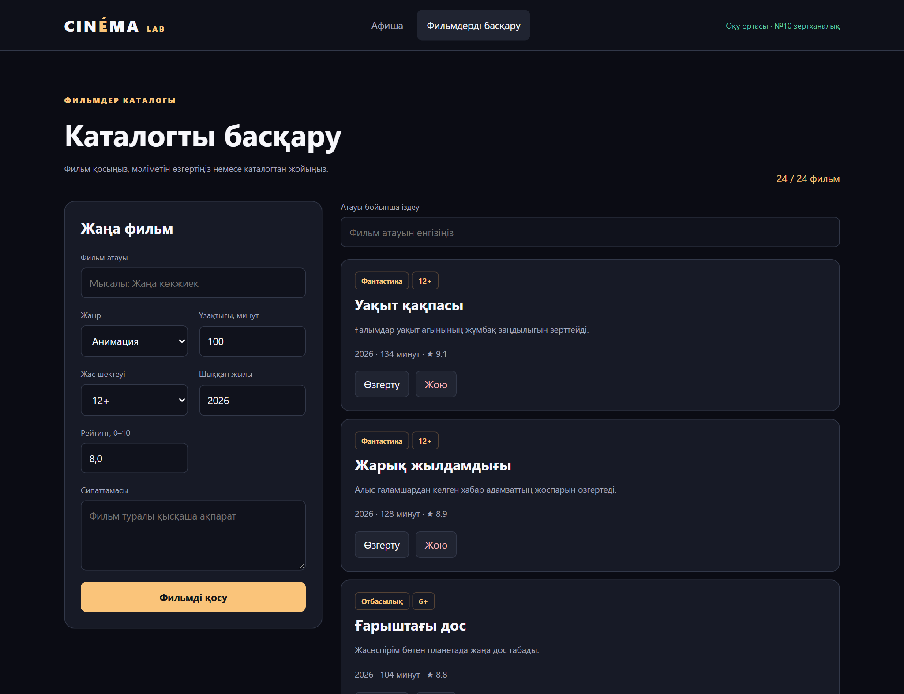
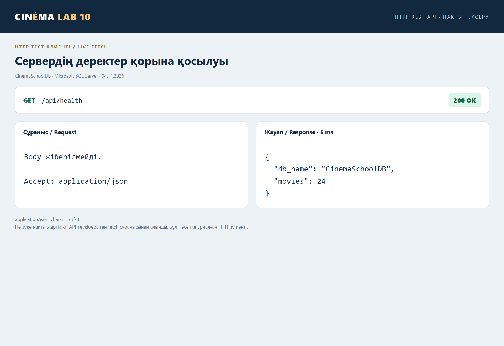
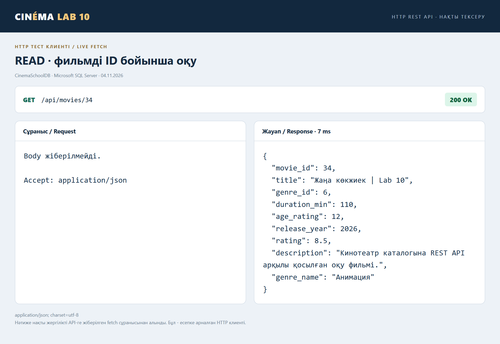
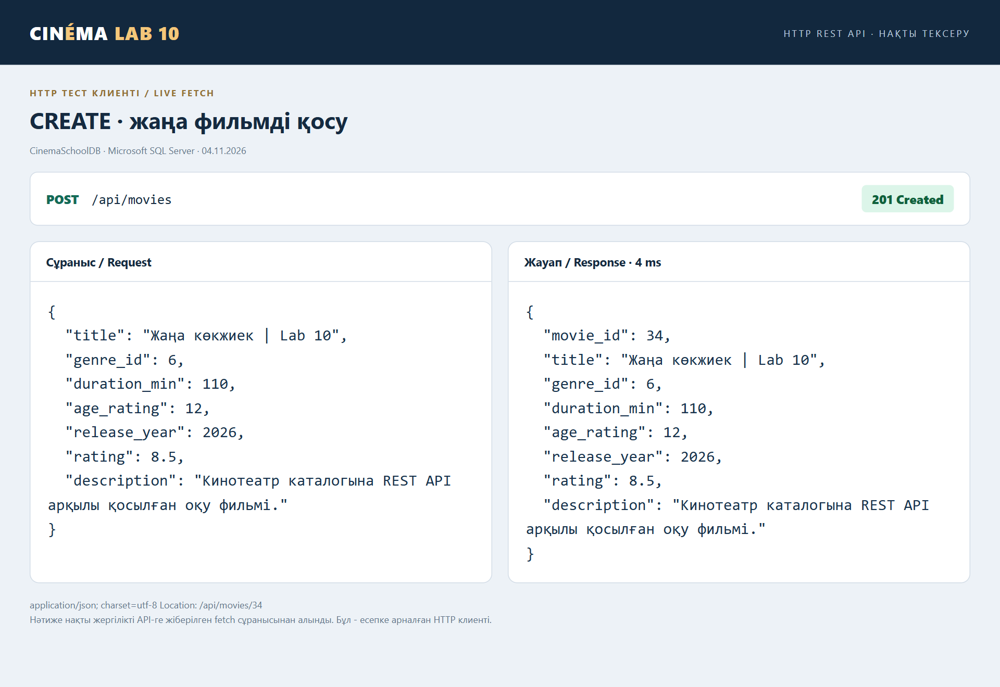
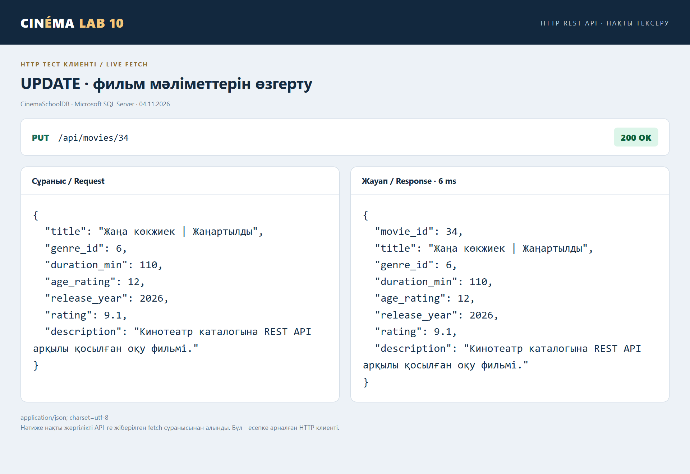
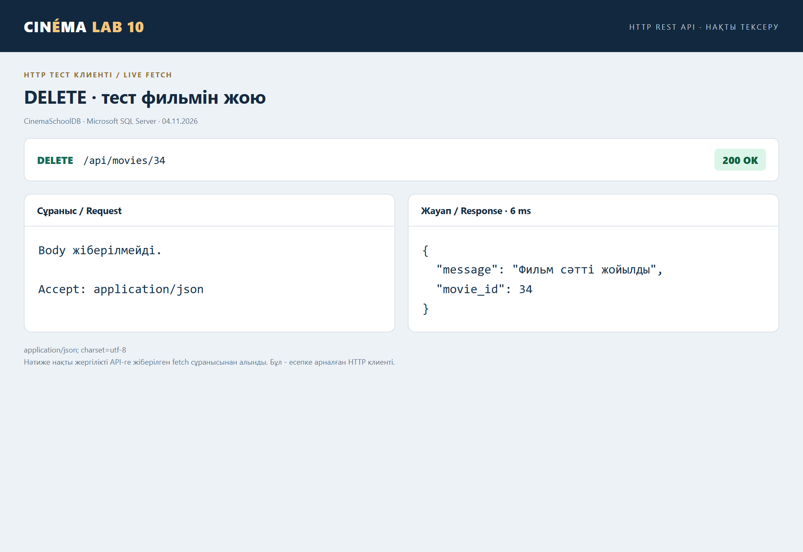
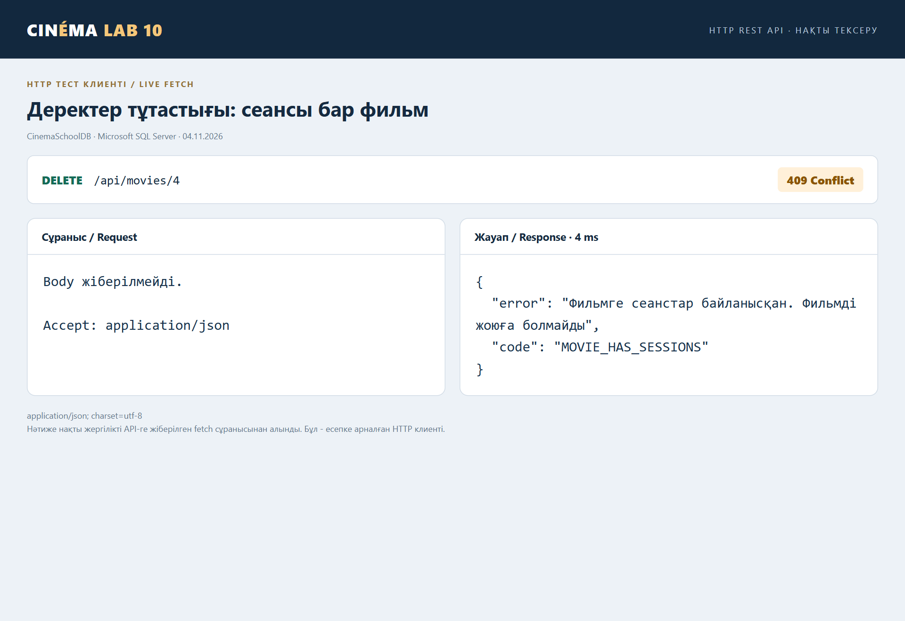
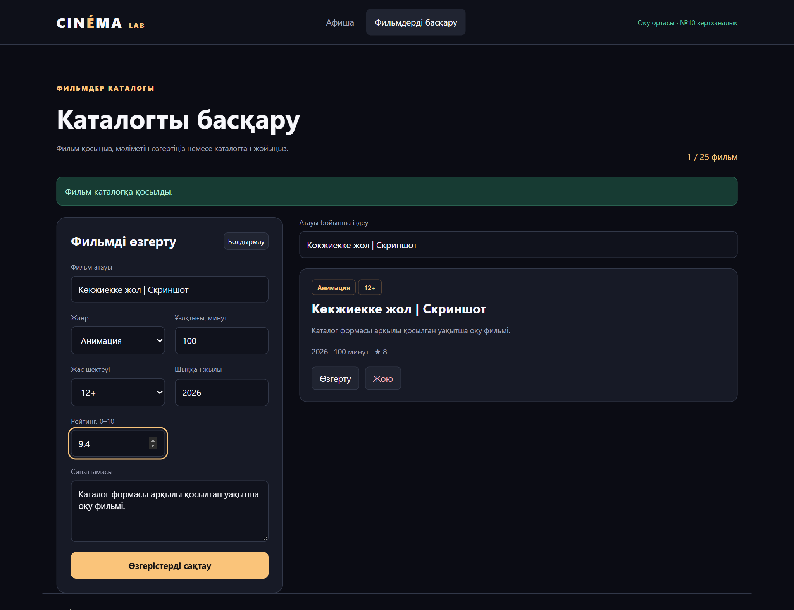
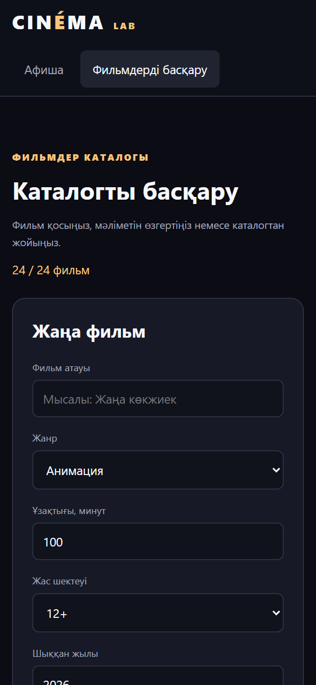
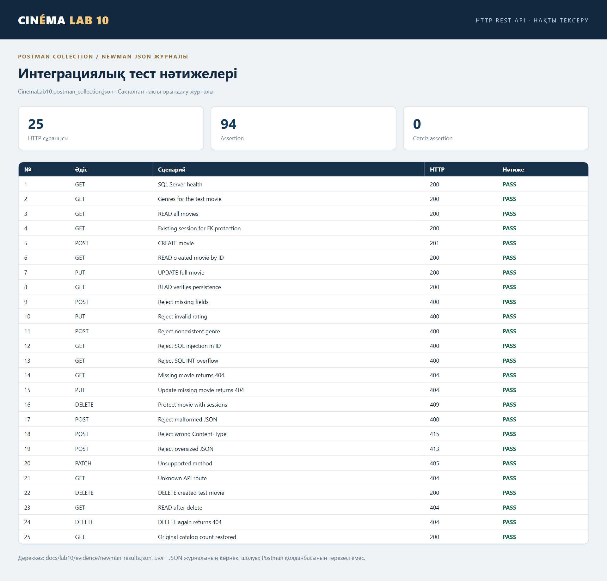

ЗЕРТХАНАЛЫҚ ЖҰМЫС №10

HTTP REST API

Кинотеатрдың ақпараттық жүйесі

Ақпараттық жүйе компоненттерінің өзара әрекеттесуі: фильмдер каталогының CRUD операциялары және Postman тестілеуі.

Орындаушы: Syrym / Syrym1234   ·   Күні: 04.11.2026

1-сурет. Жобаның нақты жұмыс істейтін каталог интерфейсі.



Node.js  +  Express  +  Microsoft SQL Server

ЗЕРТХАНАЛЫҚ ЖҰМЫС №10  /  01

Мақсат және орындалған міндеттер

---

Жұмыстың мақсаты - Node.js және Express арқылы деректер қорымен байланысқан REST API әзірлеу, CRUD операцияларын орындау және HTTP жауаптарын Postman коллекциясымен тексеру.

Нұсқаулықтағы кітапхана/MySQL мысалы кинотеатрдың Movies ресурсына бейімделді. Қолданыстағы CinemaSchoolDB базасы мен mssql драйвері пайдаланылады. API деректері SQL Server-де тұрақты сақталады.

| Талап | Орындалуы |
| --- | --- |
| Серверді әзірлеу | Express HTTP сервері, JSON middleware, REST маршруттары |
| Деректер қорымен байланыс | server/db.js: ConnectionPool және параметрленген SQL |
| Барлық жазбаны оқу | GET /api/movies -> 200, фильмдер массиві |
| ID бойынша оқу | GET /api/movies/:id -> 200 немесе 404 |
| Жазба қосу | POST /api/movies -> 201 + Location |
| Жазбаны өзгерту | PUT /api/movies/:id -> 200 |
| Жазбаны жою | DELETE /api/movies/:id -> 200 немесе 409 |
| Тестілеу | 25 сұраныстық Postman коллекциясы / 94 assertion |
| Қорытынды материал | Скриншоттар, тест журналдары және 9 бақылау сұрағы |

Компоненттер арасындағы дерек алмасу

```
Web UI / Postman
       | HTTP request + JSON
       v
Express -> validation -> mssql -> SQL Server
       ^                           |
       +---- HTTP status + JSON <--+
```

Клиент SQL Server-ге тікелей қосылмайды. Сервер сұранысты тексеріп, SQL параметрлерін дайындайды; жауап клиентке HTTP статусы және JSON түрінде қайтарылады.

ЗЕРТХАНАЛЫҚ ЖҰМЫС №10  /  02

Деректер моделі және сервер коды

---

Негізгі ресурс - Movies. Әр фильм Genres кестесіндегі жанрға тиесілі. Movies -> Sessions байланысы бар фильмді жоюға шектеу қояды. Деректер қоры: CinemaSchoolDB.

| Өріс | SQL түрі | Қабылданатын мән |
| --- | --- | --- |
| movie_id | INT IDENTITY / PK | Сервер жасайды; ID: 1..2147483647 |
| title | NVARCHAR(150) | Бос емес мәтін; ең көбі 150 таңба |
| genre_id | INT / FK | Базада бар жанрдың ID мәні |
| duration_min | INT | 1..600 бүтін саны |
| age_rating | INT | 0, 6, 12, 16, 18 немесе 21 |
| release_year | INT | 1888..2100 бүтін саны |
| rating | DECIMAL(3,1) | 0..10; ең көбі бір ондық таңба |
| description | NVARCHAR(400) | Бос емес мәтін; ең көбі 400 таңба |

Модульдердің міндеті

| Файл | Қызметі |
| --- | --- |
| server/index.js | Express, JSON middleware, error handler, серверді іске қосу |
| server/db.js | SQL конфигурациясы, ConnectionPool және қосылымды жабу |
| server/movies.js | Фильмдер ресурсының GET, POST, PUT, DELETE маршруттары |
| server/validation.js | ID, мәтін ұзындығы, JSON типтері және диапазондар |
| public/catalog.* | Форма, каталог, іздеу, өзгерту және жою интерфейсі |

SQL сұраныстарына кіріс мәндері .input(...) арқылы беріледі. Белгісіз өрістер, қате типтер және SQL INT шегінен асатын ID мәндері қабылданбайды. Клиентке SQL қатесінің ішкі мәліметтері жіберілмейді.

ЗЕРТХАНАЛЫҚ ЖҰМЫС №10  /  03

Іске қосу және SQL байланысы

---

```
npm ci
Copy-Item .env.example .env
npm start
```

Node.js 20+ және SQL Server қажет. Таза базаға sql/01_create_database.sql, кейін sql/02_insert_data.sql файлдарын бір рет орындаңыз. Бар базаға деректерді қайта енгізбеңіз.

Тексерілген жергілікті баптау

```
DB_AUTH=windows
DB_SERVER=.\SQLEXPRESS
DB_NAME=CinemaSchoolDB
HOST=127.0.0.1
PORT=3000
```

Windows Authentication үшін msnodesqlv8 және ODBC Driver 17 қолданылады. Атаулы instance кезінде DB_PORT жолын алып тастаңыз. SQL Authentication параметрлері .env.example ішінде берілген.

2-сурет. GET /api/health: CinemaSchoolDB базасымен байланыс және фильм саны расталды.



ЗЕРТХАНАЛЫҚ ЖҰМЫС №10  /  04

READ - фильм туралы ақпаратты оқу

---

GET /api/movies фильмдер массивін қайтарады. GET /api/movies/:id нақты фильмді жанр атауымен бірге қайтарады. Оқу операциялары деректерді өзгертпейді.

3-сурет. GET /api/movies/34: нақты фильмге 200 OK жауабы және JSON объектісі алынды.



| Сұраныс | Нәтиже |
| --- | --- |
| GET /api/movies | 200 OK: рейтинг, атау және ID бойынша сұрыпталған массив |
| GET /api/movies/34 | 200 OK: movie_id, негізгі өрістер және genre_name |
| GET /api/movies/2147483647 | 404 Not Found: MOVIE_NOT_FOUND |

Скриншоттардағы сұраныстар нақты жергілікті API-ге fetch арқылы жіберілді. HTTP клиентінің көрінісі есеп үшін жасалған; сұраныс пен жауап деректері capture-manifest.json файлында сақталған.

ЗЕРТХАНАЛЫҚ ЖҰМЫС №10  /  05

CREATE - жаңа фильмді қосу

---

POST /api/movies сұранысының JSON body бөлігінде жеті міндетті өріс беріледі. movie_id деректер қорында автоматты жасалады; жанр ID /api/metadata нәтижесінен алынады.

4-сурет. Жаңа фильм қосылды: 201 Created, movie_id=34; Location жаңа ресурс адресін көрсетеді.



Сервердегі сақтау логикасы

```
INSERT INTO dbo.Movies
  (title, genre_id, duration_min, age_rating,
   release_year, rating, description)
OUTPUT INSERTED.*
VALUES (@title, @genre_id, @duration_min, @age_rating,
        @release_year, @rating, @description)
```

NVARCHAR параметрлері қазақша мәтіннің сақталуын қамтамасыз етеді. Сәтті INSERT нәтижесі OUTPUT INSERTED.* арқылы алынып, клиентке 201 статусымен жіберіледі.

ЗЕРТХАНАЛЫҚ ЖҰМЫС №10  /  06

UPDATE - фильм мәліметтерін өзгерту

---

PUT /api/movies/34 сұранысы фильмнің барлық жазылатын өрісін ауыстырады. Мысалда атауы жаңартылып, рейтинг 8.5 мәнінен 9.1 мәніне өзгертілді.

5-сурет. PUT нәтижесі: 200 OK және жаңартылған title, rating өрістері.



| Ереже | Нәтиже |
| --- | --- |
| Толық PUT | Барлық жеті жазылатын өріс міндетті |
| Жоқ ID | 404 MOVIE_NOT_FOUND |
| Қате JSON мәні | 400 VALIDATION_ERROR |
| Тұрақты сақтау | Postman тізбегіндегі кейінгі GET өзгерісті қайта тексереді |

```
UPDATE dbo.Movies
SET title=@title, rating=@rating, ...
OUTPUT INSERTED.*
WHERE movie_id=@id
```

Жауапта SQL Server қайтарған жаңартылған жол пайдаланылады. PUT сұранысын бірдей деректермен қайталау ресурстың соңғы күйін өзгертпейді.

ЗЕРТХАНАЛЫҚ ЖҰМЫС №10  /  07

DELETE - фильмді жою

---

Жою тек сеансы жоқ фильм үшін орындалады. Тексеруде API арқылы жаңа қосылған уақытша фильм қолданылды; бастапқы каталог жазбалары сақталды.

6-сурет. DELETE /api/movies/34: тест фильмі жойылды, 200 OK жауабы алынды.



Жойылған ресурсқа қайта сұраныс

```
GET /api/movies/34

404 Not Found
{
  "error": "Фильм табылмады",
  "code": "MOVIE_NOT_FOUND"
}
```

Кейінгі GET сұранысы 404 қайтаратыны нақты тексерілді. Қайта орындалған DELETE те 404 береді. Бұл жоюдың соңғы күйін өзгертпейді: ресурс деректер қорында жоқ.

Тексеру аяқталғанда уақытша жазбалар тазаланып, каталогтағы фильм саны бастапқы 24 мәніне қайтарылды.

ЗЕРТХАНАЛЫҚ ЖҰМЫС №10  /  08

Қателерді өңдеу және деректер тұтастығы

---

HTTP статусы клиентке операцияның нәтижесін нақты түсіндіреді. Мысалы, сеансы бар фильмді жою 409 Conflict жауабымен тоқтатылады.

7-сурет. FOREIGN KEY байланысы сақталды: сеансы бар фильм жойылған жоқ.



| HTTP | Қате жағдайы | API коды |
| --- | --- | --- |
| 400 | Қате рейтинг, тип немесе міндетті өріс | VALIDATION_ERROR |
| 400 | Қате ID / бұзылған JSON | INVALID_ID / INVALID_JSON |
| 404 | Фильм табылмады | MOVIE_NOT_FOUND |
| 409 | Фильмге сеанс байланысқан | MOVIE_HAS_SESSIONS |
| 413 / 415 | Көлемі артық / Content-Type қате | PAYLOAD_TOO_LARGE / UNSUPPORTED_MEDIA_TYPE |
| 500 / 503 | Сервер немесе база байланысы | INTERNAL_ERROR / DATABASE_UNAVAILABLE |

rating=10.5 мәніне жіберілген POST 400 статусымен қайтарылды. Осы және басқа нақты жауаптар толық скриншоттар бумасы мен capture-manifest.json ішінде бар.

ЗЕРТХАНАЛЫҚ ЖҰМЫС №10  /  09

Каталогты басқару интерфейсі

---

Веб-интерфейс бір бетте фильм қосуға, іздеуге, өзгертуге және жоюға мүмкіндік береді. Әр әрекет API сұранысын орындайды.

8-сурет. Нақты каталог: сол жақта енгізу формасы, оң жақта іздеу және фильмдер тізімі.


Пайдаланушыға берілген мүмкіндіктер

| Әрекет | HTTP сұранысы |
| --- | --- |
| Каталогты ашу | GET /api/movies |
| Жаңа фильм қосу | POST /api/movies |
| Өзгерту формасын ашу | GET /api/movies/:id |
| Өзгерісті сақтау | PUT /api/movies/:id |
| Растап жою | DELETE /api/movies/:id |

ЗЕРТХАНАЛЫҚ ЖҰМЫС №10  /  10

Формада өзгерту және жоюды растау

---

Өзгерту батырмасы таңдалған фильм деректерін формаға жүктейді. Жою алдында пайдаланушыға растау терезесі көрсетіледі.

9-сурет. Өзгерту формасы: фильм өрістері жүктелді, рейтинг 9.4 мәніне енгізілді.



10-сурет. Жоюды растау терезесі. Сурет браузердегі dialog элементінен тікелей алынды.


ЗЕРТХАНАЛЫҚ ЖҰМЫС №10  /  11

Мобильді көрініс және браузер тексеруі

---

Интерфейс 390 × 844 өлшемінде тексерілді. Форма бір бағанға орналасады, бетте көлденең тасу анықталған жоқ.

11-сурет. Нақты мобильді скриншот: 390 × 844. Оң жақтағы мәтін тексерілген әрекеттерді түсіндіреді.



ЗЕРТХАНАЛЫҚ ЖҰМЫС №10  /  12

Postman коллекциясы және тест нәтижелері

---

Postman ішінде коллекция мен Local environment файлын Import арқылы ашып, Cinema Local ортасын таңдаңыз. Run collection пәрменін бір итерациямен бастапқы ретімен орындаңыз. movieId және genreId айнымалылары автоматты толтырылады.

12-сурет. 25 сұраныс пен 94 assertion сәтті өтті. Сурет нақты Newman JSON журналының көрнекі шолуын көрсетеді.



```
npm test
npm run test:postman
```

Дереккөз: newman-results.json. Бұл шолу Postman қолданбасының терезесі емес. Postman коллекциясы Newman арқылы орындалған. Қосымша 11 unit test және 11 браузер тексеруі өтті.

ЗЕРТХАНАЛЫҚ ЖҰМЫС №10  /  13

Бақылау сұрақтары: 1-5

---

1. API дегеніміз не және не үшін қолданылады?

API - бағдарламалардың бір-біріне функция немесе дерек ұсыну келісімі. Кинотеатрда браузер /api/movies ресурсына сұраныс жібереді, сервер SQL нәтижесін JSON ретінде қайтарады. Клиентке SQL қосылымының құпиясөзі қажет емес.

2. REST API архитектурасының негізгі ерекшеліктері қандай?

Ресурстар URI арқылы анықталады, әрекеттер HTTP әдістерімен беріледі, клиент пен сервер бөлінеді. Stateless қағидасы бойынша әр сұраныс өңдеуге қажетті мәліметті өзі қамтиды. Жауапта HTTP статусы және ресурс көрінісі болады. GET қауіпсіз, PUT пен DELETE мағыналық жағынан idempotent: қайталау ресурстың соңғы күйін өзгертпейді, бірақ жауап статусы өзгеруі мүмкін.

3. HTTP протоколы API жұмысына қалай қатысады?

HTTP әдісті, URL-ді, header мен body құрылымын және жауап статусын анықтайды. POST + Content-Type: application/json фильм деректерін жібереді, сервер 201 Created қайтарады. 400 кіріс қатесін, 404 жоқ ресурсты, 409 деректер байланысының қайшылығын көрсетеді. Осы жергілікті оқу нұсқасы HTTP қолданады.

4. CRUD операцияларының мағынасы қандай?

Create - жазба құру; Read - оқу; Update - жаңарту; Delete - жою. Бұл жобада сәйкестік: POST -> INSERT, GET -> SELECT, PUT -> UPDATE, DELETE -> DELETE. Операциялар SQL Server кестесінде орындалады.

5. GET және POST әдістерінің айырмашылығы қандай?

GET ресурсты оқиды және сервердің пәндік күйін өзгертпеуі тиіс. POST жаңа ресурс құрады, оның деректері body ішінде беріледі. POST-ты қайталау бірнеше жаңа жазба құруы мүмкін. Осы API-де GET 200, сәтті POST 201 және жаңа ресурсқа Location header қайтарады.

ЗЕРТХАНАЛЫҚ ЖҰМЫС №10  /  14

Бақылау сұрақтары: 6-9 және қорытынды

---

6. PUT және DELETE қандай мақсатта қолданылады?

PUT көрсетілген URI-дегі ресурстың жазылатын деректерін толық ауыстырады. DELETE ресурсты жояды. Бұл API-де жоқ ID 404, ал сеансқа байланысқан фильм 409 қайтарады. Қайта жоюдың жауабы 404 болғанымен, соңғы күй өзгермейді: ресурс жоқ.

7. JSON форматының рөлі қандай?

JSON - тілден тәуелсіз мәтіндік дерек форматы. Объект, массив, жол, сан, boolean және null мәндерін қолдайды. Express JSON body-ді объектіге айналдырып, res.json(...) арқылы жауап береді. Сан мен жол бөлек тип: rating: 8.5 қабылданады, rating: "8.5" қабылданбайды.

8. Node.js және Express қызметі қандай?

Node.js JavaScript-ті серверде орындайды және асинхронды енгізу/шығаруды басқарады. Express маршруттар мен middleware тізбегін ұсынады. mssql деректер қорымен байланысады. Express 4 асинхронды қателері Promise.catch(next) арқылы орталық error handler-ге жіберіледі.

9. Postman арқылы API қалай тестіленеді?

Әдіс, URL, header және қажет body таңдалып, Send орындалады. pm.test пен pm.expect статус пен JSON-ды тексереді. Runner коллекцияны ретімен орындайды; жаңа ID айнымалыға сақталады. Жұмыста толық CRUD тізбегі және қате сценарийлер тексерілген.

Қорытынды

Фильмдерге арналған толық CRUD API әзірленді және SQL Server-мен байланыстырылды. Нақты HTTP жауаптары, интерфейс әрекеттері және қате жағдайлар скриншоттармен расталды. Уақытша тест жазбалары тазаланды. Жоба жергілікті оқу ортасына арналған.

[Express 4: Error Handling](https://expressjs.com/en/4x/guide/error-handling/)

[Microsoft Learn: OUTPUT clause](https://learn.microsoft.com/en-us/sql/t-sql/queries/output-clause-transact-sql)

[Postman: test scripts](https://learning.postman.com/docs/tests-and-scripts/write-scripts/test-scripts/)

[Жобаның GitHub репозиторийі](https://github.com/Syrym1234/cinema-information-system1)

Негіз: 10-Lab.pdf нұсқаулығы, жоба коды, SQL схемасы, нақты HTTP және Newman журналдары.
