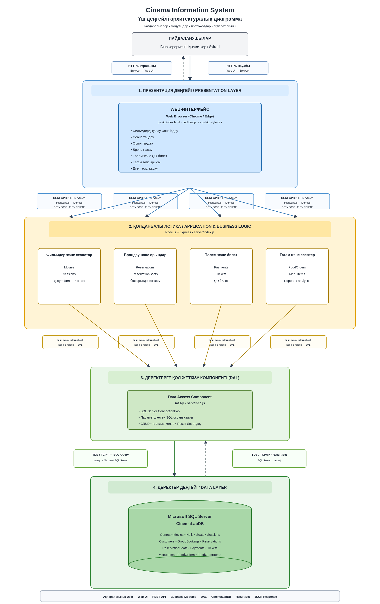
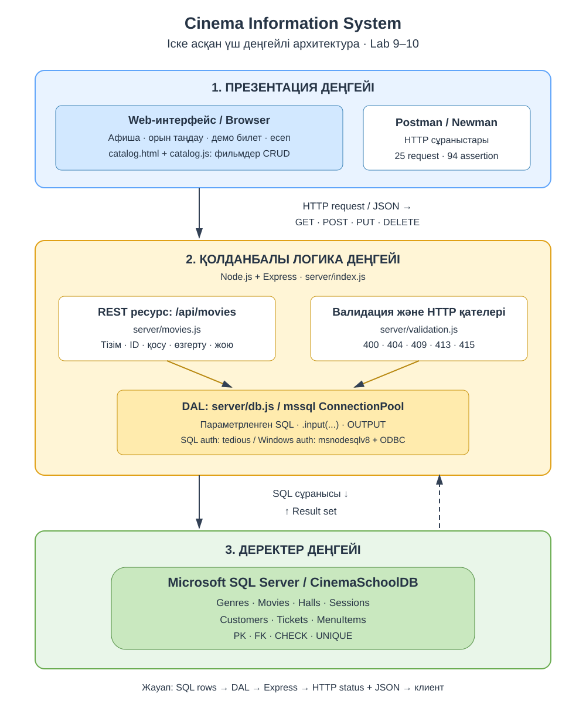
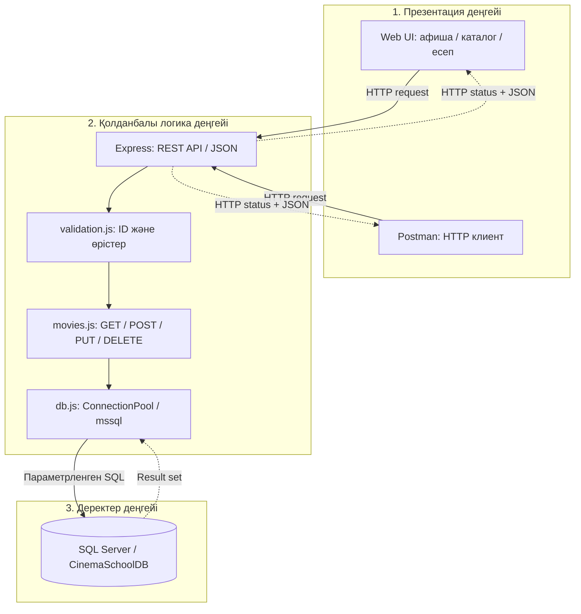

# №9 зертханалық жұмыс - ақпараттық жүйенің архитектурасы

## Берілген диаграмма

Түпнұсқа сурет өзгертілмей сақталды. Ол кинотеатрдың кеңейтілген мақсатты моделін көрсетеді: брондау, орындар, төлем, QR билет, тағам тапсырысы және аналитика. Ондағы `CinemaLabDB`, 14 кесте және `server/db.js` туралы белгілерді бастапқы репозиторийде бар мүмкіндіктермен теңестіруге болмайды.

## Репозиторийде іске асқан үш деңгей

1. **Презентация:** `public/index.html`, `public/app.js`, `public/catalog.html`, `public/catalog.js`. Афиша, билет демосы, есеп және фильмдер каталогын басқару. Postman - API-дің бөлек тест клиенті.
2. **Қолданбалы логика:** `server/index.js` маршруттары, `server/movies.js` CRUD ресурсы, `server/validation.js` кіріс деректерін тексеруі. `server/db.js` - осы деңгейдің деректерге қол жеткізу компоненті (DAL); жеке төртінші архитектуралық деңгей емес.
3. **Деректер:** Microsoft SQL Server, **CinemaSchoolDB**, жеті пәндік кесте: Genres, Movies, Halls, Sessions, Customers, Tickets, MenuItems. SQL Server-дің қызметтік `sysdiagrams` кестесі пәндік модельге кірмейді.

**Ақпарат ағыны:** пайдаланушы -> Web UI/Postman -> HTTP REST API -> валидация -> DAL -> SQL Server -> Result set -> JSON жауап. Жергілікті сервер HTTP және `127.0.0.1` адресін пайдаланады. HTTPS үшін бөлек TLS баптауы қажет; бұл нұсқада HTTPS іске қосылған деп көрсетілмейді.

## №10 жұмыспен байланысы

№9 жұмыста көрсетілген HTTP өзара әрекеттесу №10 жұмыста нақты фильм ресурсының CRUD операцияларымен жүзеге асырылды. Дерекқор атауы, кестелер және өрістер `sql/01_create_database.sql` схемасына сәйкес келеді. Төлем, QR билет, топтық брондау және тағам тапсырысы бұл нұсқаның іске асқан функцияларына жатпайды.
